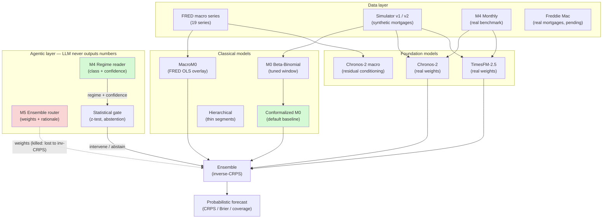
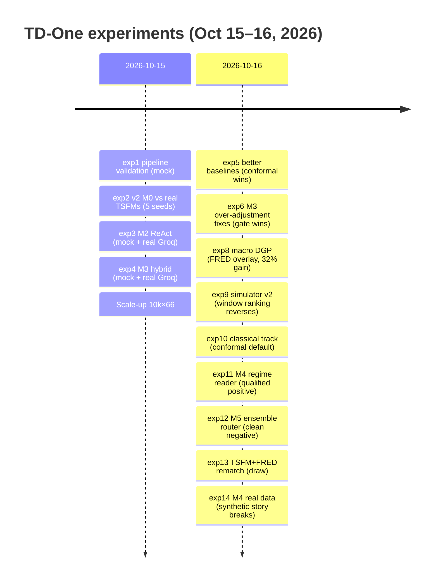
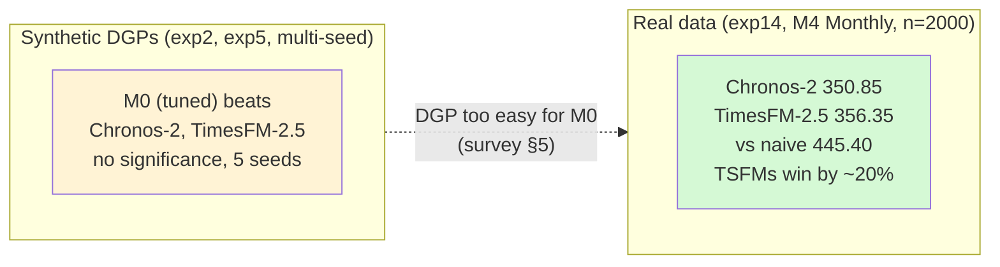

# TD-One Diagrams

Mermaid diagrams for the project. They render on GitHub.

## System architecture (from REDESIGN.md)

## Experiment timeline

## Key result: synthetic vs real

## Model ladder and verdicts

| Rung | Model | Verdict |
|------|-------|---------|
| M0 | Beta-Binomial baseline (tuned window, conformalized) | Default baseline. Strong on synthetic, loses to TSFMs on real data |
| M1 | Chronos-2 / TimesFM-2.5 (real weights) | Lose on synthetic; **win ~20% on real M4 data** |
| M2 | ReAct agent (numerical forecaster) | **Killed** — honest negative with real backend |
| M3 | Hybrid (LLM deltas + gate) | Gate helps; default-adjust killed |
| M4 | Regime reader (LLM sensor → statistical gate) | Qualified positive (3.59 vs 4.82, real Groq) |
| M5 | Ensemble router (REATS-style) | **Killed** — clean negative vs inverse-CRPS |
