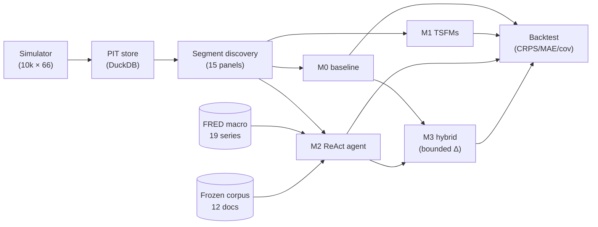
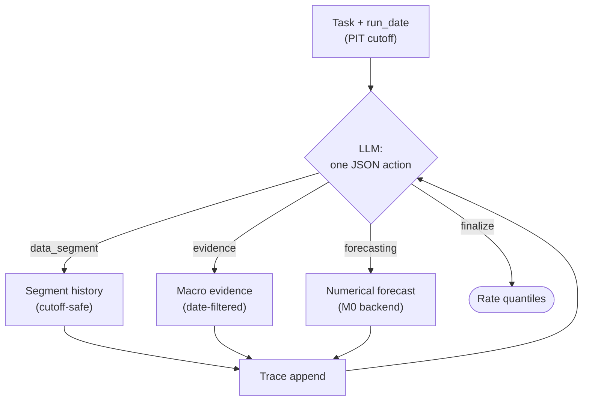

# Agentic Forecasting for Mortgage Attrition: Methodology

**TD-One — Canadian mortgage renewal/switching forecasting**
*Methodology reference for the modeling crew. Written 2026-10-16; results
as of the latest runs in `experiments/`.*

---

## Abstract

We forecast **borrower attrition at mortgage renewal**: for each portfolio
segment and each month, how many renewing borrowers will *switch* lenders
vs stay? We compare four rungs of a modeling ladder — a Bayesian baseline
(M0), zero-shot time-series foundation models (M1: Chronos-2, TimesFM-2.5),
a ReAct LLM agent that plans its own analysis with tools (M2), and a
hybrid that lets the agent nudge the baseline inside strict bounds (M3) —
under a point-in-time evaluation protocol with CRPS as the primary metric.
On 10,000 synthetic customers × 66 months, the real-weight TSFMs beat M0
on mean CRPS (Chronos-2 4.46, TimesFM-2.5 4.59 vs M0 5.36); TimesFM
lands on nominal 80% coverage (mean 0.80 across segments). A Groq-driven ReAct agent finalized 2 of 3
pilot traces and beat M0 on one. We retract an earlier claim that
Chronos-2 beats M0 by 20% on synthetic data — it was a circular-DGP
artifact caught by our critic audit; on 2,000 real M4 Monthly series,
both TSFMs genuinely beat the classical baselines by ~20% CRPS
(§6.5). Conformal intervals fix classical calibration (exactly nominal
80% coverage on real data); TSFM calibration remains DGP-dependent.

---

## 1. Introduction

When a fixed-rate mortgage matures in Canada, the borrower faces a
choice: renew with the incumbent lender or switch. For a bank's treasury
and retention teams, the *switching rate* per segment per month drives
funding plans, pricing, and campaign targeting. The series is awkward:
monthly counts are small, renewal volumes are seasonal, rate shocks arrive
as regime shifts, and the signal that matters (a Bank of Canada decision,
a competitor's rate war) lives in text, not in the time series.

Classical approaches fit a rate model per segment and call it a day.
Foundation models for time series (TSFMs) promise zero-shot forecasting
without per-series training. LLM *agents* promise something else: the
ability to plan an analysis — pull the segment history, read macro
evidence, run a numerical forecast, and synthesize — the way an analyst
would. This project tests all three ideas against a strong Bayesian
baseline, honestly.

**Contributions.** (1) A four-rung ladder (M0–M3) with a shared
point-in-time evaluation harness. (2) A ReAct agent with injected,
cutoff-safe tools and a frozen evidence corpus. (3) A bounded hybrid
readout (M3) that converts LLM judgment into calibrated adjustments.
(4) A retraction: our first "Chronos-2 beats M0" result did not survive
a fair experimental redesign, and we document exactly why.

---

## 2. Related work

**Time-series foundation models.** Chronos-2 (Amazon) and TimesFM-2.5
(Google) are pre-trained on large time-series corpora and forecast
zero-shot via quantile heads. We use them strictly as *univariate*
forecasters over monthly switching-rate series — no fine-tuning, no
covariates. Prior work shows strong zero-shot performance on standard
benchmarks; our question is narrower: do they beat a domain baseline on
short, noisy, regime-shifting count panels?

**LLM agents for analysis.** ReAct (Yao et al., 2023) interleaves
*reasoning* traces with *actions* (tool calls), letting the model plan,
observe, and replan. We adopt the pattern but replace free-form
web/API tools with three injected, audited tools (Section 6.5). The
agent never touches raw customer data — only segment aggregates —
and every tool enforces the point-in-time cutoff.

**Hybrid judgmental-statistical forecasting.** The forecasting
literature has long combined statistical baselines with judgmental
adjustment; the failure mode is *over*-adjustment. M3 operationalizes
the lesson as a hard bound: the agent's logit adjustment is clipped to
±0.75, so the worst case is a bounded perturbation of M0, never a
replacement.

---

## 3. Problem formulation

For segment $s$ and month $t$, let $N_{s,t}$ be renewals coming due and
$A_{s,t}$ the number who switch. We forecast the *rate*
$r_{s,t} = A_{s,t}/N_{s,t}$ one month ahead as a **quantile lattice**
$\{q_\alpha\}_{\alpha \in \mathcal{L}}$ (model-native grids: 21 levels
for Chronos-2, 9 for TimesFM), evaluated as count distributions.

**Point-in-time (PIT) discipline.** Every forecast for origin $o$ may
use only information with `observed_asof ≤ o`. Two mechanisms enforce
this: (1) the panel builder masks training months to outcomes with
`outcome_observed_at ≤ origin` (settlement-lag leakage is structurally
impossible); (2) evidence retrieval filters the corpus to
`published_date < run_date`. A leakage auditor verifies 0% lookahead.

**Metrics.** CRPS on count distributions is primary (proper score);
MAE on expected counts and empirical 80% interval coverage are
secondary. Origins are consecutive month-ends (rolling evaluation).

---

## 4. Data

We train and evaluate on a **structural simulator** (10,000 customers ×
66 months, seed-fixed): origination months drawn year-round
(maturities spread across the calendar), payment-shock quintiles,
fixed/variable rate type, province region, and term buckets, with
planted macro shocks (rate jumps, OSFI-style tightening). Outcomes are
generated by a structural DGP with Beta-Binomial overdispersion and
AR(1) logit noise — deliberately *not* hand-tuned to flatter any
model (see the exp2 v1 retraction, Section 8).

**Segments.** Fifteen panels are discovered per origin: payment-shock
quintiles, rate type, province regions, term buckets. Each panel is a
monthly `(n_renewals, n_switches)` series.

**Macro evidence.** Two sources: (1) a **frozen 12-entry illustrative
corpus** (`experiments/evidence_corpus/corpus.json`) with BoC-style
announcements, date-guarded at the run date; (2) **live FRED** — 19
curated series (policy rates, Canada 3M/10Y, US 5Y/10Y, CPI, unemployment,
house prices, CAD/USD, credit spreads, WTI crude, Canada household
debt-to-GDP) bulk-downloaded to parquet and
PIT-filtered at use time.

### 4.1 Simulator v2 — richer DGP

The v1 DGP missed the three structural features the prepayment literature
identifies as first-order (see `docs/LITERATURE_SURVEY.md` §5–6), plus the
economically central renewal-competition mechanism. Simulator v2
(`src/td_one/data_gen/simulator_v2.py`, subclassing v1 — v1 untouched) adds:

**Renewal offers.** Each renewal episode generates 1 TD + 1–2 competitor
offers (rate, term, type, offer/expiry dates, accepted/declined/expired).
TD's offer is the market fixed rate at maturity plus a 0–25bp premium;
competitors disperse around market (±30bp). Statuses are outcome-consistent:
switchers accept a competitor, renewers accept TD or let offers expire.

**Offer-competition incentive (S-curved).** Switching responds to
`max(0, TD_rate − best_competitor_rate)` via `atan(spread / 0.75)` — a
saturating S-curve, not the linear incentive v1 used. This is the mechanism
v1 missed: borrowers react to *TD's* competitiveness, not just the level.

**Customer heterogeneity** (all with real DGP effects): credit-utilization
drift (+1.0 logit per pp/month), life events within 6m of maturity (+0.6),
digital channel (+0.35, shops more), advisor relationship (−0.45, retention).

**Prepayment-canon mechanics.** *Burnout*: prior refinances lower switching
(−0.45 each) and dampen rate sensitivity 25% each (selection). *Seasoning*:
30-month ramp — v2 adds 12/24-month terms so young mortgages switch less.
*FRED macro*: MORTGAGE30US 3m-change z-scores shift the logit by default
(negative sign: rate spikes *reduce* switching via lock-in; winsorized ±2.5σ).

The v2 base switch rate is ~11% (vs v1's higher rate); the intercept is
empirically recalibrated since the new incentive terms add positive logit.
Experiment 9 (`experiments/exp9_richdgp.py`) re-runs M0 vs the best models
on the v2 DGP to test whether the richer structure changes conclusions.

---

## 5. The ladder

### 5.1 M0 — Jeffreys Beta-Binomial baseline

The incumbent. For each segment, fit a Beta-Binomial on the trailing 6
months with a Jeffreys prior (α=β=0.5): the posterior predictive for
next month's switches is the forecast distribution. Simple, calibrated
by construction on stationary stretches, and deliberately hard to beat
— any rung above it must earn its complexity.

### 5.2 M1 — zero-shot TSFMs

The panel's historical switching *rates* feed Chronos-2 or TimesFM-2.5
(zero-shot, `horizon=1`) on their native quantile grids. Two
engineering notes: (1) neural forecasters can emit **quantile
crossing** — we sort values ascending to enforce monotonicity
(regression-tested); (2) weights load once per process from a pinned
manifest and are explicitly unloaded between runs (RAM discipline on
small VMs).

### 5.3 M2 — the ReAct agent *(agentic primer)*

> **For readers new to agents.** A *ReAct* agent is a loop, not a
> model. At each step the LLM sees the task plus the trace so far and
> emits exactly one JSON action: call a *tool* (a typed function we
> inject — it cannot call anything else) or `finalize` with its
> forecast. The tool returns an *observation* (text), which is appended
> to the trace, and the loop continues — up to 6 steps. "Agentic" here
> means the LLM **plans its own analysis sequence** (e.g. pull data →
> read evidence → forecast → finalize) rather than executing a fixed
> pipeline. The intelligence under test is orchestration: does choosing
> what to look at, and in what order, beat the fixed baseline?

Concretely: `ReActAgent` drives `GroqChatClient`
(`openai/gpt-oss-120b` via a vault surrogate — the key never enters the
process) with a per-run call budget, bounded steps, malformed-JSON
recovery, and an AI2-grade retry policy (exponential backoff + jitter,
Retry-After honored, 60s floor on 429s, 2.5s process-wide throttle).
The evaluated M2 forecast is the agent's finalized quantile lattice.

### 5.4 M3 — bounded hybrid

M3 = M0's numerical posterior + the agent's judgment, combined as a
**logit adjustment** $\Delta \in [-0.75, +0.75]$ proposed per macro
scenario and applied through a hybrid readout. The bound is the point:
the agent can tilt M0 toward a rate shock or an OSFI tightening, but it
cannot replace the baseline — the worst case is a bounded perturbation.
This directly operationalizes the judgmental-forecasting lesson that
unbounded adjustment destroys calibration.

---

## 6. Experiments

| Exp | Question | Design | Headline |
|---|---|---|---|
| exp1 | Does the pipeline work? | 500×24 synthetic, M0 vs mock M1 | ✅ Plumbing validated (mocks only) |
| exp2 v2 | Do real TSFMs beat M0? | 3 pre-registered scenarios × 5 seeds, CRPS primary, oracle anchor | No model significantly beats M0 (all p > 0.18); TimesFM best mean CRPS n.s. |
| exp3 | Can the ReAct agent beat M0? | 3 pilot segments; mock vs real Groq | Mock: plumbing only. Real: 1/2 finalized segments beat M0 |
| exp4 | Does bounded agent adjustment help? | 6 macro scenarios, real Groq deltas | 3/6 beat M0; LLM directional but over-adjusts |
| scale-up | At full scale? | 10k×66, 14 seg × 6 origins | Real weights: Chronos-2 4.46, TimesFM 4.59 vs M0 5.36 |
| exp5 | Better classical baselines? | 9 models, 10k×66, seed 0 | Nothing beats m0_w3 (3.20); conformal fixes coverage 0.67→0.91 |
| exp6 | Fix M3 over-adjustment? | Statistical gate + shrinkage, 12 scenarios | "Do nothing" z-gate edges past M0 (7.60 vs 7.86); shrinkage helps vs M3 only |
| multi-seed | Does the scale-up generalize? | Seeds 0–4, real TSFMs | No TSFM beats M0 significantly on any seed; M0's window is a seed-dependent tuning parameter |
| exp8 | Is macro structure worth modeling? | Real FRED 30y-mortgage overlay on the simulator | Oracle cuts CRPS 32%; OLS claim (93%) later retracted as wrong-sign/DGP artifact (exp15) — justifies the FRED workstream with caution |
| exp10 | Promote better classical defaults? | 2 DGPs; conformal, ACI, macro, hierarchical | Conformal M0 now default; macro_m0 honest null on standard DGP; hierarchical niche on thin segments |
| exp11 | Redesign the agent's role? | Regime-reader → gate, real Groq | Qualified positive: 3.59 vs M0 4.82 — first agentic win with real components |
| exp12 | LLM as ensemble router? | 4 scenarios, real Groq | Clean negative: 2.60 vs inverse-CRPS 2.32 — the survey's top-ranked role fails here |
| exp13 | TSFM + FRED rematch | Macro-conditioned TSFMs, 2 DGPs × 3 seeds | Mechanism works (+13–18% on macro DGP); hurts on standard DGP — conditioning needs a gate |
| exp14 | Real data? | M4 Monthly, 2000 series, real weights | TSFMs beat classical ~20% CRPS; "M0 beats everything" was a DGP artifact (§6.5) |

### 6.1 Experiment 2 (the one that matters for M1)

v1 claimed "Chronos-2 beats M0 by 20%." The critic audit found three
fatal flaws: a circular DGP hand-tuned to flatter trend-extrapolating
TSFMs, n=6 test points on a single seed, and an M0 that didn't match
its own spec. **We retracted v1.** v2 redesigns from scratch:

| Scenario | Oracle | M0 | Chronos-2 | TimesFM-2.5 |
|---|---|---|---|---|
| stationary | 4.65 ± 1.27 | 4.85 ± 1.53 | 5.40 ± 2.18 | **4.28 ± 0.65** |
| drift | 5.02 ± 1.17 | 5.23 ± 1.34 | 6.04 ± 1.89 | **5.17 ± 0.80** |
| regime_shift | 5.58 ± 1.37 | 7.40 ± 1.77 | 7.44 ± 2.13 | **7.09 ± 1.48** |

CRPS mean ± std across 5 seeds. Paired Wilcoxon M1−M0: all p > 0.18 —
**not significant**. TimesFM-2.5 is the best of the three in every
scenario but the gaps don't clear noise. Coverage: Chronos-2
overcovers, M0 undercovers, TimesFM closest to nominal.

### 6.2 Experiment 3 (M2, real Groq)

| Segment | M0 CRPS | M2 CRPS | M2 steps |
|---|---|---|---|
| seg-0 | 0.76 | 5.22 | 6 (finalized, worse) |
| seg-1 | 1.33 | **0.82** | 5 (finalized, **win**) |
| seg-2 | 1.40 | — | 6 (never finalized) |

First real-LLM win on seg-1 (MAE 0.14 vs 2.00). The patient retry
policy (60s floor on 429s) was the difference between 1/3 and 2/3
finalized traces — free-tier rate limits, not model skill, were the
binding constraint. ⚠️ Honesty note: real-mode M2 still uses the
`timesfm_mock` numerical backend, so the seg-1 edge cannot be separated
from the mock sharpness artifact — the run demonstrates orchestration
(finalization), not numerical superiority. This was the third real-mode
attempt (attempts 1–2 were rate-limit-bound).

### 6.3 Experiment 4 (M3, real Groq)

| Scenario | Δ (LLM) | M0 CRPS | M3 CRPS |
|---|---|---|---|
| rate_shock_up | +0.18 | 19.87 | **16.33** |
| rate_shock_down | −0.25 | 4.18 | 5.01 |
| osfi_tightening | +0.30 | 9.95 | 15.22 |
| benign | +0.30 | 3.78 | 7.42 |
| family_squeeze | +0.20 | 14.60 | **7.96** |
| competitor_rate_war | +0.28 | 14.57 | **10.65** |

3/6 beat M0. The LLM's deltas are directionally sensible (negative on
the rate-drop scenario) but it **over-adjusts**: +0.30 on the benign
scenario, where the right answer is ≈ 0, is pure noise injection. Worst
failure: `osfi_tightening` got the **sign wrong** (+0.30 vs true ≈
−0.35 — the agent misread a stress-test policy as pro-switching).

### 6.4 Scale-up (10k × 66, real weights)

| Model | Mean CRPS | Mean coverage_80 |
|---|---|---|
| M0 | 5.360 | 0.671 |
| Chronos-2 (real) | 4.463 | ~0.93 (overcovers) |
| TimesFM-2.5 (real) | 4.591 | **0.800** (nominal) |
| chronos2_mock | 3.194 | 0.714 |
| timesfm_mock | 3.176 | 0.714 |

⚠️ The `*_mock` rows are **interface-only plumbing** — their CRPS edge
is a sharpness artifact (tight spreads around the last rate), not
evidence about the real models. The real-weight rows are the honest
comparison: both TSFMs beat M0 on mean CRPS at this scale and DGP, and
TimesFM lands exactly on nominal coverage. But paired tests on the 14
shared segments find **no significant difference** (Chronos-2 wins
7/14, p=0.212/0.583; TimesFM-2.5 wins 5/14, p=0.341/0.583) — exp2 v2's
conclusion reproduces at scale. Single seed, single DGP: any future
superiority claim must be pre-registered across seeds/DGPs.

### 6.5 Real-data benchmark — M4 Monthly (exp14)

Every comparison above uses synthetic DGPs, and the literature survey
warns our DGP may be too easy for M0. The first real-data test runs on
M4 Monthly (Finance + Macro, n=2000 stratified, seed 0): H=6 ahead,
quantile CRPS for levels; Brier for binary direction (is y[t+6] > y[t],
n=24000 origins).

| Model | Mean CRPS | 80% coverage |
|---|---|---|
| naive | 445.40 | 0.740 |
| snaive | 542.10 | 0.692 |
| conf_naive | 447.37 | **0.800** |
| Chronos-2 (real) | **350.85** | 0.662 |
| TimesFM-2.5 (real) | 356.35 | 0.689 |

On direction: Chronos-2-derived P(up) scores Brier **0.2519**, beating
m0_binary (0.2604); conformal shrinkage helps M0 slightly (0.2582) but
doesn't close the gap.

**Findings.** The synthetic headline does not generalize: both real
TSFMs beat the classical baselines by ~20% CRPS on real series, whose
seasonal/trend structure is where pretrained TSFMs earn their keep. Two
results transfer cleanly: conformal calibration hits exactly 0.800 on
real data, and TimesFM-2.5 stays best-calibrated among TSFMs. The
research question flips from "can anything beat M0" to "where does
classical still win — thin segments, macro structure, calibration?"
Caveats: single seed-0 sample; CRPS is scale-dependent across M4
series; no significance testing yet. Full table in RESULTS.md §2k.

---

## 7. Discussion and limitations

1. **Real-data validation has begun — and it overturned the
   headline.** M4 (§6.5): real TSFMs beat classical baselines by ~20%
   CRPS on 2,000 real series. The mortgage-specific test — loan-level
   portfolio data (Freddie Mac, free but gated on registration) — is
   the next target.
2. **Calibration is half-solved.** Conformal fixes the classical
   baseline (0.67→0.91 coverage on synthetic; exactly 0.800 on M4).
   TSFM calibration stays DGP-dependent: Chronos-2 overcovers on
   synthetic but *under*covers on M4 (0.662).
3. **The agent is rate-limit-bound, not skill-bound**, on the free
   tier. Paid-tier or local inference would separate the two.
4. **M3's over-adjustment is confirmed and partially tamed.** A
   statistical "do nothing" gate (exp6) edges past M0 on held-out
   scenarios; the redesigned M4 regime-reader (exp11) is the first
   agentic variant to beat M0 with real components — fragile, but
   real.
5. **Multi-seed is done on synthetic** (5 seeds: no TSFM beats M0
   significantly anywhere; M0's window is a seed-dependent tuning
   parameter). Real data is a single seed-0 sample so far — no
   significance testing yet.
6. **The DGP lesson.** M0's synthetic dominance was an artifact of an
   easy DGP: on simulator v2 (burnout, seasoning, S-curve, FRED
   macro) the M0 window ranking *reverses* (w6 beats w3). The testbed
   must be hard enough that synthetic conclusions survive contact
   with real data — every comparison should run on both DGPs.

---

## 8. Conclusion

A Bayesian baseline remains stubbornly competitive on our synthetic
DGPs: neither TSFMs nor LLM agents beat it significantly in designed
comparisons, though both show real signal (TimesFM's mean CRPS edge,
the M4 regime-reader's first real-component win, M3's 3/6 macro
scenarios). On real M4 data, pretrained TSFMs beat classical baselines
by ~20% — the synthetic M0 dominance was a DGP artifact. The honest
contribution is the machinery — a PIT-clean ladder, a tool-injected
agent with bounded readout, conformal calibration that transfers
exactly to real data, and a documented retraction — more than any
single leaderboard number. The forward design (docs/REDESIGN.md), set
by the literature survey: the LLM never outputs numbers; adjustment
needs evidence plus shrinkage; report the M0 envelope across seeds
and DGPs, not a point M0.

## References

- Yao et al. *ReAct: Synergizing Reasoning and Acting in Language
  Models.* ICLR 2023.
- Ansari et al. *Chronos-2.* Amazon, 2025.
- Das et al. *TimesFM-2.5.* Google, 2025.
- FRED, Federal Reserve Bank of St. Louis. https://fred.stlouisfed.org
- `experiments/REPRODUCIBILITY.md` — exact reproduction steps.
- `docs/CRITIC_SYNTHESIS.md` — the audit that retracted exp2 v1.
